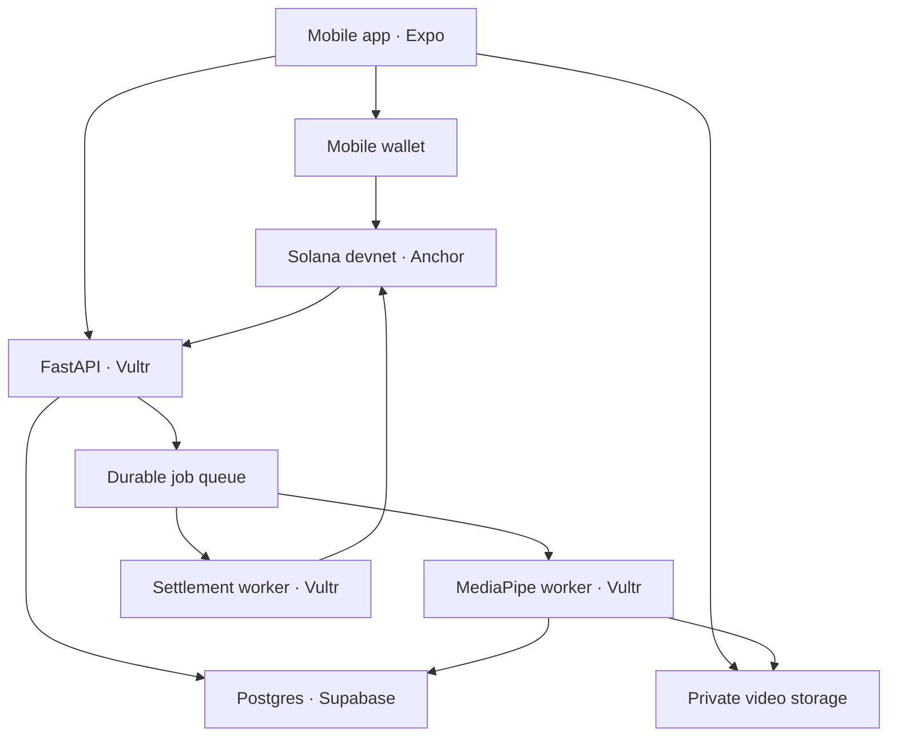

# Moltivate architecture

> Updated 14 November 2026. The static browser frontend described below is implemented. The native app, verification service, and Solana program remain proposed implementation targets. A local backend foundation exists (`services/api/`, `supabase/migrations/`): off-chain challenge drafts, team membership, workout-session submission, and scoreboard progress, runnable locally against SQLite or Postgres. It is not deployed, has no wallet authentication or authorization, and talks to no object storage, verification worker, or Solana program — see `services/api/README.md` for exact scope and gaps. The scoring and payout example is a proposal to confirm before contract implementation.

Moltivate turns exercise commitments into a social competition: join a team, commit a deposit, record a workout, and see the challenge settle. The mobile experience leads with self-improvement and belonging. The hackathon positioning is **Entertainment**; the planned end-to-end demonstration will use **Solana devnet and test SOL**.

## Implemented browser frontend

The current website is a presentation and interaction prototype for the mobile product. It is a static application under `apps/web/`, using native HTML, CSS, and JavaScript ES modules without package dependencies or a framework runtime.

| Current file | Responsibility |
| --- | --- |
| `apps/web/index.html` | Landing-page content, navigation, sections, and app-availability dialog |
| `apps/web/styles.css` / `fonts.css` | Responsive page design and local font declarations |
| `apps/web/editorial.css` | App-icon and navigation treatment, sponsor ribbon, retro chat, Polaroids, and origin-story layout |
| `apps/web/motion.css` / `motion.js` | Centered hero, copper shine, glossy CTA, scroll chapters, device perspective, one-time object reveals, and system motion preferences |
| `apps/web/app.js` | Navigation, dialog behavior, and sponsor-ribbon duplication; imports the custom elements |
| `apps/web/phone-demo.js` | `<moltivate-demo>` with scoped styles and simulated mobile interaction states |
| `apps/web/club-board.js` | `<club-board>` with scoped styles, bounded simulated SOL feed, search, filters, sorting, and crew details |
| `apps/web/club-peek.js` | Top-of-page preview and modal standings drawer, subscribed to the Club feed |
| `apps/web/club-theme.js` | Neutral black leaderboard and dialog styles; green/red performance figures |
| `apps/web/rolling-amount.js` | Accessible signed fixed-decimal digit reels, exact settled values, and reduced-motion behavior |
| `apps/web/assets/` | Original app icon, self-hosted fonts, official sponsor marks, and illustrative photography, with source/license records |
| `apps/web/IMAGE-SLOTS.md` | Numbered photo locations and replacement guidance |
| `scripts/build.mjs` | Recreates `dist/` from the source directory using Node's standard library |

State lives in the current browser session. The components do not connect to a wallet, camera, API, database, or Solana network. Reps, teams, rankings, and reward figures are illustrative; clicking a simulated claim does not submit a transaction. The App Store action opens a coming-soon dialog instead of implying that a store listing exists.

The page loads Fraunces, DM Sans, and La Belle Aurore from local assets. Components use native custom elements and scoped Shadow DOM styles. The Club feed advances deterministic display fixtures every 4.5 seconds while the board, top preview, or standings drawer is visible. It updates figures in place to preserve search focus and pauses when every surface is offscreen, the document is hidden, or a crew details dialog is open. Digits use cancellable Web Animations; no live financial data is fetched.

`<club-peek>` reads `weeklySnapshot()` and listens for `moltivate:club-feed`. Its visibility is reported through `setExternalVisible()`, so both surfaces use the same model and timer. The page's existing scroll frame sends `setStoryProgress()` to fold, lift, slide, and fade the preview as the phone enters; scrolling up reverses it. The transform applies only to the opener wrapper, never to the native modal. Keyboard focus and an open drawer hold the preview stable. Reduced motion removes the spatial transition. Opening it shows weekly net-reward rankings, a demo label, and a link to the full Club. Escape, backdrop, and close-button dismissal restore focus and scrolling. The full-Club link transfers focus to that section. Mobile uses a compact edge tab.

The Club CTA dispatches `moltivate:get-app`, which the page handles by opening the availability dialog.

The phone follows scroll position only on viewports at least 901 px wide and 800 px high with effects enabled. The three chapters select existing demo screens; they never submit actions or alter workout results. `setStoryStage()` respects manual pause, open dialogs, and active sets. The component emits `moltivate:demo-state` to synchronize the surrounding captions. Direct interaction pauses the story; **Follow scroll** resumes it. Replay resets the demo and leaves scroll following paused. On smaller screens, the phone remains in normal flow and its optional automatic tour pauses while offscreen or the document is hidden.

The pinned story has three viewport heights of travel, with 30% for the crew, 42% for the workout, and 28% for the result. Chapter ticks fill locally, while the bottom track shows overall progress. Boundary hysteresis prevents small scroll reversals from flickering between screens.

Perspective uses CSS transforms, not a WebGL model or downloaded video. Scroll listeners are passive and work is coalesced into animation frames. Text remains readable without waiting for a reveal. There are no page-level animation switches. System reduced motion disables pinning, perspective, and automatic screen progression. See [motion design notes](docs/motion-design.md) for the rationale and research.

The sponsor ribbon repeats one decorative logo group for continuous movement. Its duplicate is hidden from assistive technology and removed from keyboard focus; reduced-motion settings stop it, and hovering or focusing a logo briefly holds it for interaction. Each original logo links to its track's explanation. These sections describe planned work: Vultr backend deployment, Solana devnet commitments, and exploration of Chert video/messaging infrastructure. They do not establish live integrations, customers, or endorsement. Chert is not the rep-counting verifier; the MediaPipe plan below remains separate.

The retro chat is an illustrative conversation, and photo slot **1** uses the user-supplied Teletubbies gym image in a full portrait Polaroid, as an illustration. The former Unsplash asset is retained with its provenance but no longer displayed. Slot **2** uses the user-supplied vintage gym photo in a responsive portrait Polaroid, also as an illustration. Maintain accurate captions and provenance when replacing either slot; see [IMAGE-SLOTS.md](apps/web/IMAGE-SLOTS.md), [sponsor sources](apps/web/assets/sponsors/ASSET-SOURCES.md), and [photo sources](apps/web/assets/photos/ASSET-SOURCES.md).

From the repository root, use Node.js 24 (pinned in `.node-version`), `npm run check` for JavaScript syntax, `npm run build` to create `dist/`, `npm run check:build` to validate the static output, and `npm run preview` for local HTTP preview. The site has no runtime dependencies. `npm ci --ignore-scripts` installs the pinned Playwright development dependency; `npm run test:e2e` runs desktop/mobile browser checks against the built site at a project subpath. `.github/workflows/demo.yml` runs checks on PRs and main pushes, delivers tested artifacts, and optionally deploys to GitHub Pages only when selected. The existing private Site still publishes through Sites; see [CI/CD](docs/ci-cd.md) for that boundary and hosting setup.

This web layer introduces and demonstrates the product. It does not replace the planned Expo application or establish that native camera, wallet, verification, or settlement integrations work. The remainder of this document specifies that future system.

## 1. Planned system shape

Arrows show communication or data reads, not custody transfers. Deposits go from the participant's wallet into the program-controlled vault. The API and video worker never receive users' wallet keys or hold their deposits.

| Component | Planned responsibility | Authority boundary |
| --- | --- | --- |
| React Native / Expo / TypeScript | Onboarding, team lobby, challenge rules, camera capture, progress, wallet approvals, receipts | Display server and chain state; never declare its own reps valid |
| FastAPI on Vultr | Authentication, challenge metadata, uploads, progress, job creation, chain reconciliation | Validate ownership on every request; do not accept client-supplied scores |
| MediaPipe Python worker | Decode clips, estimate poses, run exercise-specific rep counting, produce versioned verification results | Trusted verification service; pose detection alone is not proof of identity or liveness |
| Supabase Postgres | Profiles, challenge metadata, workout records, job state, chain-state projections | Authoritative for off-chain records; chain remains authoritative for deposited and claimable funds |
| Private object storage | Short-lived workout clips | Signed upload/download access; no public video bucket |
| Settlement worker | Freeze verified results, build and submit authorized result transactions, reconcile retries | Has the result-authority key; cannot replace wallet authorization for deposits or claims |
| Anchor program | Challenge rules, roster, escrow, result acceptance, payout calculation, claims and refunds | Checks signer, accounts, deadlines, states and conservation of funds |

Proposed repository layout for the first scaffold (paths marked *exists* have a local foundation; the rest remain proposed):

| Path | Contents |
| --- | --- |
| `apps/mobile/` | Expo application and platform wallet adapters |
| `services/api/` *(exists, partial)* | FastAPI routes for draft challenges, team membership, session submission, and scoreboard progress. No auth, escrow, or verification worker yet |
| `services/verifier/` | MediaPipe processing and exercise counters |
| `services/settlement/` | TypeScript chain client, result submission and reconciliation |
| `programs/moltivate/` | Anchor program and contract tests |
| `packages/contracts/` *(exists, partial)* | Generated workout-session JSON Schema today; IDL and other shared client schemas remain proposed |
| `supabase/migrations/` *(exists, partial)* | `users`, `challenges`, `teams`, `team_members`, `workout_sessions` only |
| `infra/` | Docker configuration, environment examples and deployment notes |

## 2. Mobile and SDK decisions

- Use Expo development builds and test camera recording and wallet signing on real phones before building the full interface. Expo Camera supports recording video; it does not supply the exercise counter. [Camera reference](https://docs.expo.dev/versions/latest/sdk/camera/).
- Android: Mobile Wallet Adapter with the matching React Native client. MWA needs native modules and a development build; Expo Go is insufficient. [Solana Mobile installation](https://docs.solanamobile.com/get-started/react-native/installation).
- iOS: validate Phantom universal links, encrypted sessions and return handling as a separate integration. Current Phantom guidance uses `https://phantom.com/ul/` for new universal links. Do not assume the Android wallet integration works on iOS. [Phantom reference](https://docs.phantom.com/phantom-deeplinks/deeplinks-ios-and-android).
- Anchor's current TypeScript client documentation requires legacy `@solana/web3.js` v1. Proposed MVP choice: a pinned Anchor-compatible v1 client and matching mobile-wallet package, isolated behind a wallet/chain interface. Solana Mobile otherwise recommends Kit for new applications. Resolve and lock the complete dependency set during the first spike; do not mix incompatible primitives or copy unpinned examples. [Anchor compatibility](https://www.anchor-lang.com/docs/clients/typescript).
- Keep ordinary account screens usable when a wallet is disconnected. A funded challenge entry requires a completed wallet signature and verified chain state.
- The `.club` brand direction is accepted. Confirm the exact purchased hostname before configuring API DNS, associated domains, wallet identity and redirect allowlists.

## 3. Challenge lifecycle

| State | Entry condition and behavior |
| --- | --- |
| `OPEN` | Creator records immutable terms: exercise, equal team sizes, fixed target, deposit, joining cutoff, workout window, processing grace, settlement deadline, result authority and rules version |
| `READY` | Required slots are funded; the completed roster is locked. Terms were already immutable at creation, before any deposit |
| `ACTIVE` | Scheduled start has arrived; anyone may trigger the valid state transition |
| `VERIFYING` | Workout window has ended; existing accepted uploads may finish processing during the fixed grace period |
| `SETTLED` | Authorized results arrive after processing grace ends and before the settlement deadline; contract fixes entitlements once |
| `REFUNDABLE` | Joining cutoff passes without a complete roster, or settlement deadline passes without a result |

Require `join_cutoff <= workout_start < workout_end < verification_end < settlement_deadline`. Settled and refundable outcomes are mutually exclusive. State transitions enforce chain time; a mobile countdown is informational. Time passing does not execute a transaction by itself. A worker or participant must submit the relevant transaction. There is no discretionary cancellation after funding in this MVP; incomplete enrollment and settlement timeout are the defined refund paths.

1. **Create:** show the complete challenge terms and publish their on-chain parameters before taking deposits.
2. **Join and deposit:** one instruction atomically enrolls a wallet and transfers the exact stake into its challenge vault. A failed transfer cannot create a funded participant. Reject duplicate membership, full teams and late joins.
3. **Record:** issue a single-use workout session bound to the participant, challenge and exercise. Start camera capture inside the app and upload through a scoped signed URL. MVP uploads must finish within the workout window; processing may continue during grace.
4. **Verify:** a worker counts accepted reps and writes a versioned result. The API aggregates each participant's accepted work once; pending or rejected sessions do not contribute.
5. **Settle:** wait until the fixed verification window has closed. If all timely uploads were resolved within that window, the settlement worker submits the immutable roster's completion flags before the later settlement deadline. The contract checks the authorized signer, timing and state, then computes the outcome and entitlements itself. If any timely upload remains unresolved because of infrastructure/processing failure, do not settle or treat that failure as non-completion; let the settlement deadline enable principal refunds for everyone.
6. **Claim:** each participant signs a claim against their own entitlement. The contract marks the claim and transfers atomically; repeat claims fail.
7. **Recover:** if settlement never arrives, a permissionless timeout transition enables individual principal refunds. No administrator or video worker must be online for a participant to trigger an eligible refund.

An RPC accepting a transaction is not confirmation. Show `awaiting approval`, `submitted`, `confirmed`, `finalized`, `failed` and `expired` states as appropriate. Use finalized chain state as the financial source of truth; confirmed updates can appear provisionally. [Transaction submission](https://solana.com/docs/rpc/http/sendtransaction).

## 4. Proposed scoring and payout baseline

**This section is a concrete demo proposal, not an already agreed economic rule.** Start with two equal teams, preferably 2v2, one supported exercise, the same completion target per person, and the same deposit. Finalize these rules before accepting any demo deposits.

- A participant completes the challenge by reaching the fixed target through accepted workouts within its window.
- Each completer contributes one team point. Extra reps do not add points or increase rewards; display partial progress separately.
- The team with more completers wins. Every completer recovers their own principal, including completers on the losing team.
- Non-completers forfeit their deposits. Only completers on the winning team divide that forfeited pool; an inactive teammate receives no winning-team bonus.
- A tie, including zero completions on both teams, returns every participant's principal. Disclose that ties are refunds, not wins.
- A challenge that cannot fill or cannot settle by its deadline also refunds principal. No platform fee, yield, token issuance or random payout is part of this proposal.

Let each deposit be `S` integer lamports, `M` the number of non-completers, `K` the winning team's number of completers, and `F = M × S`. For a non-tie:

| Participant | Claimable amount |
| --- | --- |
| Winning-team completer | `S + floor(F / K)`, plus one lamport for each of the first `F mod K` eligible roster indices |
| Other completer | `S` |
| Non-completer | `0` |

The stable roster index determines rounding, never claim order. Since a non-tied winner has at least one completer, `K > 0`. For a tie, each participant claims `S` instead. Sum of all entitlements must equal total deposited stakes; keep account rent and transaction fees outside that calculation. Use integer arithmetic throughout, serialize large integers as decimal strings across JSON, and test overflow boundaries.

Example: four participants deposit 100 units each. Team A has two completers and Team B one. The fourth person's 100 units become the bonus pool: A's members claim 150 each, B's completer claims 100, and the non-completer claims zero. Total: 400. Units are illustrative; the demo denomination is test SOL expressed in lamports.

This model caps the value of extra exercise and discourages carrying inactive teammates. It does not solve collusion, multiple identities or ability matching. Keep those limitations explicit and avoid claiming a fair real-money marketplace from this demo alone.

## 5. Proposed data model

| Record | Essential fields and invariants |
| --- | --- |
| `users` / `wallets` | Internal user ID, display name, verified wallet address; wallet changes cannot redirect an existing funded entry |
| `challenges` | ID, creator, exercise/verification version, target, team size, stake lamports, UTC deadlines, program/cluster, chain address, state projection |
| `participants` | Challenge, wallet, team, stable roster index, deposit signature, funded status; unique challenge + wallet |
| `workout_sessions` | Session ID, participant, single-use nonce, expiry, object key/hash, upload time, processing state, accepted reps, reason codes |
| `verification_results` | Session, model/counter version, counted reps, confidence summary, disposition; immutable revisions with one active accepted result |
| `jobs` / `outbox` | Kind, idempotency key, payload reference, attempt count, lease expiry, next retry, terminal error |
| `settlements` | Challenge, frozen completion vector, evidence digest, rules version, expected outcome, submitted signature, confirmed/finalized status |
| `chain_events` | Cluster, program, signature, instruction/event index, slot; unique ingestion key to prevent duplicate projection updates |

Media lives in object storage, not Postgres or on-chain. The database stores private object references and derived results. A settlement evidence digest supports audit correlation; it does not prove that a workout happened.

## 6. Program accounts and instructions

Use a deterministic challenge PDA and a program-controlled vault PDA per challenge, plus participant records or a small bounded roster. PDAs have no private keys. Validate seeds, owner, canonical bump and all account relationships. [PDA reference](https://solana.com/docs/core/pda).

| Proposed instruction | Required checks |
| --- | --- |
| `create_challenge` | Creator signature, unique ID, valid deadlines, bounded roster and amounts, fixed rules version and oracle key |
| `join_challenge` | Participant signature, open state, time/capacity/team bounds, exact stake, unique wallet; transfer and enrollment succeed together |
| `activate_challenge` | Fully funded equal teams, scheduled start reached, immutable roster; permissionless |
| `settle_challenge` | Authorized result signer, `verification_end <= chain_time < settlement_deadline`, exact bounded roster results, no prior terminal outcome |
| `enable_refunds` | Missed enrollment or settlement deadline, eligible state, no settled outcome; permissionless |
| `claim` / `refund` | Participant signature and matching destination, applicable terminal state, unclaimed entitlement, sufficient escrow |

Prefer a small result vector and one settlement transaction for the hackathon. Check transaction size and compute usage against the compiled implementation before selecting the roster limit. A larger tournament architecture is out of scope.

The backend is an **oracle**: it can submit false completion flags if compromised. A signature authenticates the sender, not the truth of an exercise. The contract can enforce authorized settlement, deterministic accounting and deadlines; it cannot independently inspect video or eliminate this trust assumption.

Keep the result-authority key separate from deployment/upgrade authority. Record both public keys and their powers in deployment documentation. An upgradeable program must not be described as immutable. No general administrator withdrawal of participant escrow belongs in this design. [Program model](https://solana.com/docs/core/programs).

## 7. Proposed API surface

| Route group | Behavior |
| --- | --- |
| `POST /auth/nonce`, `POST /auth/verify` | Issue expiring challenge text, verify wallet signature, consume nonce, issue short-lived app session |
| `POST /challenges`, `GET /challenges/{id}` | Draft/read metadata and immutable rules; creation still needs the corresponding chain transaction |
| `GET /challenges/{id}/leaderboard` | Return accepted progress, pending verification and financial finality separately |
| `POST /workouts`, `POST /workouts/{id}/complete` | Authorize a session/upload; finalize an uploaded object and enqueue verification once |
| `GET /workouts/{id}` | Return processing status, accepted reps and actionable rejection reasons to the owner |
| `GET /challenges/{id}/settlement` | Return frozen outcome, claim/refund availability and chain receipts |
| `GET /health`, `GET /ready` | Basic liveness and dependency readiness without secrets |

These routes do not exist yet. Generate the eventual client contract from FastAPI's OpenAPI schema. Mutation requests use scoped idempotency keys; a reused key with a different payload is a conflict.

## 8. Authentication, verification and privacy

- Sign-in text binds a random single-use nonce, wallet, app identity, intended network, issue time and expiration. Verify exactly that message; consume the nonce atomically before issuing a session. A valid wallet signature proves wallet control, not one-person-one-account identity.
- Store mobile session secrets with platform-backed secure storage. Validate wallet callback state and allowed redirect targets; do not log encrypted-session material or ask users for seed phrases.
- Backend authorization derives the user from the session. Verify challenge membership and ownership independently of IDs supplied by the client. Keep Supabase service credentials and oracle keys exclusively server-side.
- Begin with one exercise and a tested camera angle. MediaPipe supplies pose landmarks; implement and version the rep state machine, confidence gates and acceptable motion criteria separately. [Pose Landmarker](https://ai.google.dev/edge/mediapipe/solutions/vision/pose_landmarker/python).
- Apply duration, content-type, decoded-frame and file-size limits. Bind uploads to fresh session tokens, reject exact duplicate clips, and validate timestamps. These checks reduce simple reuse but do not prevent edited video, replay through another camera or identity sharing.
- Return `accepted`, `rejected` or `needs_retry` with clear reasons. Low confidence, missing joints and interrupted uploads must not silently become zero-rep accepted sessions. Permit a new attempt while the challenge window remains open.
- Request camera access at recording time. Do not record audio for rep verification. Avoid face recognition, background capture and publishing raw workouts by default.
- Proposed retention: delete raw clips after settlement/refund plus a 24-hour debugging window; expire abandoned uploads sooner. Confirm this policy before collecting videos and show it in the capture flow. Keep only the minimum derived audit record needed afterward.

## 9. Jobs, deployment and recovery

Start with one Vultr CPU VM running separate API, video-worker and settlement-worker containers, with resource limits. Keep Postgres managed in Supabase. Use a private object-storage bucket; provider selection remains open. A Postgres-backed leased job table/outbox is sufficient initially and avoids requiring Redis before it is needed.

- Put the API behind HTTPS, use health checks and restricted service networking, and keep database connections encrypted. Do not expose worker ports publicly. Vultr documents hosting a custom FastAPI service behind a reverse proxy. [Deployment reference](https://docs.vultr.com/how-to-deploy-a-fastapi-application-with-gunicorn-and-nginx-on-ubuntu-2404).
- Commit a workout record and its verification job in one database transaction. Workers claim jobs with leases; retries use bounded backoff and the same operation identity. A unique accepted-result constraint prevents duplicate rewards after a crash.
- Freeze the result snapshot in a database transaction. Before submitting or retrying settlement, reconcile the current chain state and prior signature. An expired blockhash permits rebuilding a transaction only after checking whether the original landed.
- Reconcile deposits, settlements and claims from chain state after restarts. Do not treat a browser callback, client signature string or cached database row as proof of payment.
- Measure clip latency, queue depth, worker memory and verification error rate with real phone recordings before choosing a VM size or GPU. CPU hosting is the starting experiment, not an unmeasured throughput guarantee.
- Keep runtime secrets out of git and mobile bundles. Restrict the result key to the settlement process; maintain encrypted database backups and record deployed program ID, cluster, build revision and verifier version.
- Log request/job IDs and transaction signatures without videos, signed media URLs, tokens or keys. An unavailable oracle must eventually lead to the contract's existing refund path.

## 10. Build order and acceptance gates

1. **Integration spike:** one real Android and iPhone can capture a clip, connect the intended wallet, sign a nonce and return to the app. Lock compatible package versions and choose the primary demo phone.
2. **Contract loop:** local tests cover create, atomic join/deposit, terminal states, settlement, claims and timeouts; then deploy the same flow to devnet with test SOL.
3. **Verification loop:** upload one supported exercise, process it on the Vultr CPU worker, and inspect repeatable results against hand-counted clips across lighting and framing variations.
4. **Product loop:** connect funded membership, accepted workout progress, team outcome and a finalized transaction receipt. Demonstrate retry and refund behavior as well as success.

Contract tests must cover unauthorized settlement, wrong accounts, late joins, roster mutation, duplicate membership, early settlement, conflicting terminal transitions, duplicate claims, tie/no-completion refunds, uneven division, amount bounds and conservation of funds. Backend checks cover replayed sign-in nonces, cross-user access, duplicate jobs, failed uploads, worker restarts and RPC timeouts. Phone/client checks cover wrong network or program configuration, permission denial, wallet cancellation, app backgrounding and return links.

## 11. Decisions to settle before implementation

- Confirm the proposed scoring, forfeiture, tie and rounding rules; exercise, target, team size and all timing windows.
- Confirm the exact `.club` hostname and which platform/device anchors the demo.
- Select pinned Expo, wallet, Anchor and Solana SDK versions after the integration spike.
- Select private object storage, raw-video retention and verifier rejection thresholds.
- Confirm whether any manual review is needed during the fixed processing window; never add post-settlement edits to entitlements.

Live streaming, broad exercise recognition, matchmaking, on-device inference, collectible evolution, mainnet deposits and production-scale anti-cheat remain outside this initial architecture. Revisit them after the complete devnet loop works.

## Primary references

- [Solana quick start](https://solana.com/docs/intro/quick-start) — the project's foundational blockchain reference.
- [Solana transactions](https://solana.com/docs/core/transactions) — atomic instruction execution; failed transactions can still incur fees.
- [Solana Mobile React Native setup](https://docs.solanamobile.com/get-started/react-native/installation), [Anchor TypeScript client](https://www.anchor-lang.com/docs/clients/typescript), and [Phantom mobile links](https://docs.phantom.com/phantom-deeplinks/deeplinks-ios-and-android) — recheck these together when resolving dependencies.

Official documentation was checked on 14 November 2026. Links describe platform capabilities; Moltivate-specific rules and system choices above are design proposals.
